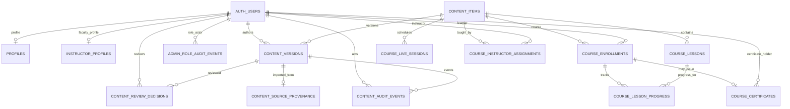

# Clinova — Database ERD, Security and Delivery Plan

**Status:** Detailed implementation baseline for review; not a production migration.
**Database:** Existing Clinova Supabase project `ssxpmcbqfdggfsoqbxac` (PostgreSQL 17.11).
**Repository branch:** `docs/clinova-rebuild-architecture`.
**Safety:** No live DDL, grants, role assignment, data writes, secrets, or deployment are performed by this document.

## 1. Verified current-state inventory

- 17 public tables; all returned row counts were zero at audit time.
- 48 public RLS policies (policy inventory below shows domain-level coverage).
- 2 public views; both were previously confirmed as `security_invoker=true`.
- 19 recorded migrations.
- 0 Auth users at audit time; therefore no real user lifecycle or role journey has been exercised.
- One private storage bucket, `course-resources`, currently private and empty.
- Existing public role helper reads `app_metadata.clinova_roles` and legacy `app_metadata.role='admin'`; it does not use user-editable metadata.
- Existing CMS publication flow requires independent clinical, editorial and release approvals for the exact content hash; author cannot approve own content.
- Existing learner/course tables and CMS are a useful foundation, not a complete academy ERP/LMS/certification system.

### Existing 17 public tables

| Domain | Existing relation | Purpose |
|---|---|---|
| Identity | `profiles` | Basic learner/staff profile linked to Auth |
| Faculty | `instructor_profiles` | Public profile and verification evidence |
| CMS | `content_items` | Programme/CPD/article identity |
| CMS | `content_versions` | Versioned JSON snapshot and publication state |
| CMS | `content_review_decisions` | Hash-bound clinical/editorial/release decisions |
| CMS | `content_source_provenance` | Legacy source traceability |
| CMS | `content_audit_events` | CMS append-only event history |
| Admissions/contact | `contact_submissions` | Public contact enquiries |
| Partnerships | `partnership_inquiries` | Initial partner enquiries |
| Marketing | `newsletter_subscriptions` | Newsletter sign-ups |
| CPD | `course_instructor_assignments` | Course teaching assignments |
| CPD | `course_enrollments` | Learner course applications/enrolments |
| CPD | `course_lessons` | Course lesson content |
| CPD | `course_live_sessions` | Scheduled teaching sessions |
| CPD | `course_lesson_progress` | Per-enrolment lesson progress |
| CPD | `course_certificates` | CPD completion certificates |
| Access audit | `admin_role_audit_events` | Existing role-change audit events |

### Existing relationship map

## 2. Security correction plan

### Finding

The inspected live grants show excessive table privileges for `anon` and `authenticated`. These include broad `INSERT`, `UPDATE`, `DELETE`, `TRUNCATE`, `REFERENCES` and `TRIGGER` grants on learner, profile, certificate and teaching relations. RLS predicates do not make a `TRUNCATE` grant safe. The public-schema default privileges also grant broad relation privileges to API roles, so correcting existing tables alone would allow the problem to recur for future tables.

This is a least-privilege defect. It is not, by itself, proof that an unauthenticated caller can read or alter rows: the effective access path also depends on PostgREST exposure, RLS, schema privileges, policies and function execution.

### Target grant model

1. Revoke blanket table grants from `anon` and `authenticated` across the exposed schema, then explicitly grant only the operations required by each approved API workflow.
2. Correct default privileges for every role that creates objects in `public` (at minimum the inspected owners `postgres` and `supabase_admin`) so future tables do not automatically receive broad API-role grants.
3. Preserve service-role operational access only for trusted server-side processes. Never expose service-role credentials to a browser or prefix them with `NEXT_PUBLIC_`.
4. Keep public submissions narrow: anonymous INSERT only on contact, newsletter and partnership enquiry intake; no public SELECT, UPDATE, DELETE or TRUNCATE.
5. Public catalogue reads should use approved published-content and verified-faculty projections. Public verification should use a narrow function that returns only fields deliberately approved for disclosure.
6. Learner data: authenticated SELECT only for own rows and explicitly assigned teaching/administrative scope; INSERT/UPDATE only where the matching policy supports the operation; no direct learner deletion.
7. Certificates, assessment results, financial records, role assignments and audit evidence must not be directly writable by ordinary users. Use validated domain commands and append-only event records.
8. Views must remain `security_invoker=true`; audit their columns and underlying RLS. Never expose private notes, email, phone, evidence paths or internal decisions through public views.
9. Audit function EXECUTE grants and default function privileges. Public SECURITY DEFINER functions require explicit justification, fixed search paths, strict caller authorization, minimal return columns and negative tests.
10. Keep the private schema inaccessible to API roles at schema level. Private SECURITY DEFINER functions may be invoked only through deliberate public wrappers where required.

### Intended API grant matrix (subject to workflow implementation)

| Relation/domain | anon | authenticated | Trusted server |
|---|---|---|---|
| Contact/newsletter/partner intake | INSERT only | INSERT; staff SELECT by policy | operational processing |
| Published catalogue / public faculty views | SELECT approved projection | SELECT approved projection | full |
| Profiles | none | own SELECT/INSERT/UPDATE; authorized staff scoped read | full |
| Enrolments | none | own INSERT/SELECT; scoped staff SELECT; approved admin UPDATE | full |
| Lessons / live sessions | none | published/assigned SELECT; assigned instructor writes | full |
| Lesson progress | none | own SELECT/INSERT/UPDATE; assigned staff SELECT | full |
| CPD certificates | verification function only | own/admin SELECT; issuance/revocation via command | full |
| CMS audit/review/provenance | none | staff SELECT only when authorized | controlled functions |
| Role assignments | none | no direct table writes; own minimal role summary if needed | privileged provisioning function |
| Applications, evidence, finance, exams, certification, quality | none | per-owner/assignment/role policy only | server-only command path |

### Required RLS negative tests

Test as `anon`, learner A, learner B, instructor A, instructor B, admissions officer, finance officer, assessor, certification decision-maker, quality officer, partner A, partner B, content editor, reviewer, publisher and super administrator.

Required denials include:
- learner A cannot read or mutate learner B's profile, application, documents, enrolment, assessment attempt, result, invoice or evidence;
- instructor A cannot access an unassigned course or unrelated learner;
- partner A cannot access partner B's institution, cohort or learner records;
- assessor cannot decide/issue the same candidate's certification;
- content author cannot review or publish their own content;
- finance staff cannot change academic results or certification decisions;
- ordinary administrators cannot grant themselves super-administrator rights;
- anon cannot enumerate private tables, private storage objects or raw certificate records;
- no API role can truncate, alter schema, create triggers or bypass RLS.

Do not simulate privileged identities against production by inserting test users. Use an isolated database seeded with synthetic identities and data. Verify both positive and negative cases.

## 3. Role assignment and administrator provisioning

### Source of truth

Move from the current small CMS-only `app_metadata` role array as the long-term authority to a protected relational assignment model in a non-exposed schema. Keep Auth as identity/session provider; keep role assignment as academy governance data.

Proposed relations:
- `clinova_private.roles`: stable role key, display name, description, privileged flag, active state.
- `clinova_private.permissions`: stable permission key, domain, action and description.
- `clinova_private.role_permissions`: many-to-many role/permission mapping.
- `clinova_private.user_role_assignments`: user, role, optional scope type/id, granted by, valid-from, valid-until, revoked-at and reason.
- `clinova_private.role_assignment_events`: append-only grant/revoke/expiry event with actor, target, role, scope, reason and timestamp.
- `clinova_private.admin_bootstrap_events`: one-time bootstrap audit record; never a public API table.

Scope assignments to institution, programme, cohort, course, scheme or case where required. Global role assignment must be exceptional.

### Role catalogue

- `super_admin`: platform configuration and privileged provisioning; strongest MFA and audited actions.
- `academy_admin`: operational oversight without unrestricted role self-elevation.
- `admissions_officer`: applicant review and admission decisions.
- `finance_officer`: invoices, payments, refunds and reconciliation.
- `learner` / `applicant`: own records only.
- `instructor`: assigned CPD course and learner scope.
- `content_author`, `clinical_reviewer`, `editorial_reviewer`, `content_publisher`: separate CMS duties.
- `assessor`: assigned assessment/certification evidence submission.
- `eligibility_reviewer`: eligibility review for a versioned professional scheme.
- `certification_decision_maker`: independent certification decision.
- `impartiality_officer`: conflicts, impartiality and quality oversight.
- `quality_officer`: controlled documents, audits, complaints, appeals and corrective actions.
- `partner_manager`: contract-bound institution and cohort scope.

Avoid a single generic `admin` role for all operations.

### First administrator bootstrap

1. Create the first account through the normal Auth invitation flow; verify email and enforce MFA before privileged access.
2. Confirm the intended person's Auth UUID through a trusted administrative channel.
3. Run a one-time, reviewed bootstrap operation from a protected migration/operations context. Do not expose a bootstrap endpoint, public RPC, client-side key or signup metadata path.
4. Record the bootstrap actor, target UUID, timestamp, reason and change ticket in the append-only audit log.
5. Remove/disable the bootstrap capability after success and verify a second bootstrap attempt fails.
6. All subsequent role changes go through a privileged server command that checks the actor's active scoped permission, requires a reason, prevents self-grant of equal/higher privilege and writes an immutable event.
7. Revocation/expiry must take effect on the next authorization check. JWT role claims may be cached; use short session lifetime/refresh or DB-backed authorization for sensitive commands. Do not rely on stale claims for immediate revocation.
8. Require dual control for super-admin assignment, certification decision authority, and high-risk credential revocation.

The existing Auth signup trigger may create a basic profile from user metadata; that metadata must never grant roles.

## 4. Target domain ERD additions

The following are proposed normalized relations. Final column types, constraints, indexes, retention rules and exact schema placement are to be completed in reviewed migrations after the existing ERD and authorization tests are accepted.

### Admissions
- `applications` — applicant Auth user (nullable for pre-account enquiry), unique application reference, programme/intake, state, submitted timestamp.
- `application_documents` — application FK, private storage object key, document type, checksum, uploaded-by, review state; no public object URLs.
- `application_reviews` — reviewer, review type, decision, rationale, evidence refs, reviewed application version/hash.
- `admission_decisions` — final decision, decision-maker, reason, decision timestamp; applicant cannot decide own application.
- `application_status_events` — append-only transition history.
- `intakes` — programme version, application open/close, delivery dates, capacity, status.

### Institutions and partnerships
- `institutions` — legal/display name, country, registration identifiers where applicable, status.
- `institution_contacts` — named contact records with restricted PII.
- `partner_agreements` — institution, agreement version, effective dates, scope, status, approved document.
- `institution_memberships` — Auth user, institution, scoped role, validity.
- `partner_cohorts` — institution, programme/course intake, dates, capacity.
- `partner_cohort_learners` — cohort/user membership with audit trail.
- `partnership_reviews` — due diligence, approval and renewal decisions.

### Finance
- `fee_schedules` / `fee_schedule_items` — versioned fee definitions by programme/intake/partner and currency.
- `invoices` / `invoice_lines` — immutable issued amounts, currency, tax fields where applicable, due date and state.
- `payment_transactions` — provider, provider reference, amount, currency, verified event status and timestamps; never store raw card data.
- `payment_allocations` — transaction-to-invoice allocation.
- `refunds` — approved refund request, reason, amount, approver and provider reference.
- `finance_events` — append-only payment reconciliation and invoice state events.
- Provider webhook signatures and idempotency keys must be verified server-side. Payment success is never inferred from a browser redirect.

### Assessments and examinations (CPD domain)
- `assessment_definitions` — course/version, assessment type, pass criteria and version.
- `assessment_items` — versioned question/item bank, item type, marks and controlled answer key.
- `assessment_options` — normalized options for objective items.
- `assessment_attempts` — learner, enrolment, assessment version, attempt number, started/submitted timestamps and state.
- `assessment_responses` — attempt/item, answer payload constrained by item type, awarded marks and marker.
- `assessment_marks` — marker, rubric version, mark, feedback and timestamp.
- `assessment_results` — calculated outcome, pass/fail, moderation status, released-at.
- `assessment_moderation` — independent sample/review and outcome.
- `completion_decisions` — eligibility snapshot, reviewer, rationale and decision.
- `assessment_events` — append-only lifecycle events.

Do not expose answer keys to learners before the attempt closes. Enforce attempt limits, server-side timing rules where required, idempotent submission and immutable submitted responses. CPD certificates remain distinct from competency credentials.

### Professional competency certification (separate bounded domain)
- `certification_schemes` / `certification_scheme_versions` — controlled scheme and criteria version.
- `competency_units` / `competency_criteria` — versioned competence framework.
- `certification_applications` — candidate, scheme version, reference, eligibility state.
- `candidate_evidence` — private file/object metadata, criterion mapping, submitted version, integrity hash.
- `eligibility_reviews` — reviewer, decision, reason and version.
- `assessor_assignments` — candidate/scheme, assessor, scope, conflict declaration.
- `competency_assessments` — assessment plan, method, result and assessor.
- `assessment_observations` — criteria-level evidence and judgement.
- `impartiality_declarations` / `impartiality_reviews` — conflict declaration and independent disposition.
- `certification_decisions` — independent decision-maker, evidence snapshot/hash, outcome and reason.
- `professional_credentials` — unique credential reference, scheme version, holder, issue/expiry/revocation.
- `credential_events` — append-only issue, renewal, suspension, withdrawal and correction events.
- `certification_appeals` / `appeal_decisions` — independent appeal handling.

CPD completion must not create a professional competency credential. The public verification endpoint must disclose only credential reference, holder display name if approved, scheme title/version, status and dates. It must not expose candidate evidence, assessment notes, contact details or internal decision rationale.

### Quality management and operations
- `controlled_documents` / `controlled_document_versions` — document code, owner, version, approval, effective/review dates and access class.
- `quality_audits` / `audit_findings` — scope, criteria, auditor, finding, severity, evidence and close-out.
- `corrective_actions` — finding/source, owner, due date, root cause, action, effectiveness check and closure.
- `complaints` / `complaint_events` — restricted case records and status history.
- `appeals` / `appeal_events` — separate appeal workflow and independent reviewer.
- `risk_register_items` / `risk_reviews` — risk owner, treatment and review cadence.
- `staff_competency_records` — role competence, evidence and review dates.
- `operational_events` — normalized domain events for reporting; avoid duplicating source-of-truth fields.
- `reporting_snapshots` — controlled, privacy-minimised reporting aggregates with defined refresh time and owner.

Quality and certification records need retention schedules, legal holds and restricted access. Audit records should be append-only and corrections represented by new events.

## 5. Workflow acceptance criteria

### Admissions
- Public application submission creates a reference and private document upload slots.
- Applicant can save/resume and view only their own application.
- Admissions staff can review, request information and decide with a reason.
- Applicant cannot review/decide own application.
- Every state transition is auditable; rejected/withdrawn records are retained according to policy.

### Institutional partner lifecycle
- Enquiry → due diligence → approval → agreement → institution contacts/memberships → scoped cohorts → renewal/suspension.
- A partner user cannot enumerate another institution or cohort.
- Agreement expiry or suspension blocks new cohort activity according to policy.

### Finance
- Fee schedule is versioned and bound to an intake/contract.
- Invoice lines snapshot price/currency at issuance.
- Webhook is signature-verified and idempotent.
- Refund requires authorized approval and provider confirmation.
- Finance role cannot edit grades, assessment outcomes or certification decisions.

### CPD assessment
- Instructor configures assessment version and rubric.
- Learner receives only published assessment content; answer key remains server-only.
- Attempt submission is atomic/idempotent.
- Marking/moderation and result release are distinct states.
- Completion decision is traceable to the course and assessment versions.
- Certificate issue is an explicit authorized operation and revocation is audited.

### Professional certification
- Scheme version and criteria are frozen for each candidate application.
- Eligibility, assessment, impartiality and certification decision are separate stages.
- Assessor cannot be final decision-maker for the same candidate.
- Candidate evidence is private and hash/version tracked.
- Credential issue, suspension, renewal and revocation create immutable events.
- Public verification returns minimal approved data only.

### Quality and reporting
- Controlled documents have version, owner, approver and review date.
- Findings link to evidence and corrective actions.
- Corrective action closure requires effectiveness check.
- Complaints and appeals are handled by independent authorized staff.
- Reports are permission-scoped, reproducible and exclude unnecessary personal data.

## 6. Next.js application integration

### Current repository reality

The repository is still a Vite + React SPA using React Router and `@supabase/supabase-js`; it is not yet Next.js. It already contains route shells for admissions, applications, certification, assessment, quality, admin, learner and faculty workspaces. Some role workspaces explicitly render as unavailable. These routes do not prove their backend workflows are operational.

### Target integration

- Replatform to Next.js App Router + TypeScript on a dedicated feature branch.
- Preserve reviewed Clinova brand assets, verified copy and useful domain UI components; do not bulk-copy route logic or draft catalogue data.
- Use `@supabase/ssr` for cookie-aware server/client clients and server-side `getUser()`/claims validation.
- Browser uses publishable key only. Server-only secrets are not imported by client components.
- Server Actions/Route Handlers validate input, enforce authorization, perform domain transitions and write audit events.
- Use Zod schemas at every external boundary; never trust role, price, result, completion, certificate state or institution scope from the client.
- Add typed data-access functions by domain; UI components do not issue ad hoc privileged SQL.
- Public pages read only published projections; private portals read through authenticated server boundaries and RLS.
- Use private Storage buckets for applications, candidate evidence and controlled records with short-lived signed access and explicit ownership checks.
- Preview environment must use isolated test data and disabled real payment/email side effects.

### Required end-to-end test journeys

1. Public contact/newsletter/partner enquiry.
2. Applicant registration, application, private document upload, review and decision.
3. Learner sign-in, own enrolment, course access and progress.
4. Instructor assigned-course access and lesson/session management.
5. CPD assessment attempt, submission, marking, moderation, completion and certificate issue/verification/revocation.
6. Partner manager scoped institution/cohort reporting.
7. Invoice creation, payment webhook idempotency and refund approval in sandbox.
8. Certification candidate application, eligibility, evidence, assessment, impartiality, independent decision, credential issue/verification/revocation/appeal.
9. Quality audit, finding, corrective action and effectiveness check.
10. Admin invitation, MFA, role grant/revoke, failed self-elevation and audit trail.
11. Cross-user, cross-institution and cross-role negative RLS tests.
12. Keyboard accessibility, responsive layouts, error/loading/empty states and audit-log observability.

## 7. Delivery gates

| Gate | Deliverable | Exit criteria |
|---|---|---|
| G0 | Security grant/RLS correction proposal | Exact object matrix, default ACL correction, RPC/view audit, synthetic negative test suite |
| G1 | Role and bootstrap implementation | First-admin one-time process, scoped roles, grant/revoke/expiry, dual control and audit |
| G2 | Existing ERD and migration baseline | All current relations, constraints, indexes, policies, triggers and dependencies documented |
| G3 | Admissions, institutions, finance | Normalized schema, private documents, scoped RLS, provider sandbox |
| G4 | CPD assessment/examination | Versioned item bank, attempts, marking, moderation and results |
| G5 | Professional certification | Separate scheme/candidate/evidence/decision/credential lifecycle |
| G6 | Quality and operations | Controlled documents, audit evidence, corrective actions, complaints, appeals and reporting |
| G7 | Next.js integration | SSR auth, server-only secrets, typed domain services, accessible workflows |
| G8 | Release readiness | Passing lint/typecheck/unit/E2E/security/performance tests, backup/rollback, explicit owner release approval |

No gate authorizes production migration or deployment by itself. Production changes require a separate approval after review of the exact migration diff, tested rollback, backup status and operational window.

## 8. Follow-up grant and public-surface inspection (2026-11-12)

A second read-only pass inspected exact per-table grants, default ACLs, function grants and view definitions. This refines the initial finding:

### Exact privilege pattern

- anon and authenticated currently have all table privileges (including TRUNCATE, REFERENCES, TRIGGER and DML) on the majority of learner, profile, certificate and instructor relations.
- anon currently has only INSERT on the three intake tables, but has broad privileges on course_certificates, course_enrollments, course_instructor_assignments, course_lesson_progress, course_lessons, course_live_sessions, profiles and the verified_instructors view.
- authenticated has broad DML/DDL-adjacent relation privileges on the same academic tables, despite RLS policies restricting row-level operations.
- anon and authenticated also have SELECT on some internal CMS audit relations. RLS restricts rows, but grants should be narrowed to policy-backed staff use cases.
- postgres and supabase_admin default ACLs in public grant broad table privileges to anon, authenticated and service_role. This is the recurrence mechanism: future tables can inherit excessive API grants.
- No custom default ACLs were found for clinova_private; new functions in that schema need explicit default-function hardening because PostgreSQL normally grants function EXECUTE to PUBLIC by default.

### Function allow-list and wrappers

Public RPCs intentionally required by current workflows:
- has_clinova_role(text) — anon/authenticated role predicate helper.
- verify_cpd_certificate(uuid) — public verification.
- CMS RPCs — authenticated only: archive, create item/version, issue CPD certificate, publish, record review, submit for review and withdraw.

Private implementation functions called by those wrappers need matching explicit EXECUTE grants. Public wrapper functions are invoker functions; the private verifier is SECURITY DEFINER with search_path=pg_catalog. Keep clinova_private USAGE for now because the current public verifier wrapper is invoker and calls the private function. Do not revoke private-schema USAGE until the wrapper architecture is deliberately changed and tested.

### Public views and privacy

Both public views are confirmed security_invoker=true:
- published_content exposes content_item_id, content_version_id, kind, version, full JSON snapshot, content hash and publication timestamp. The full snapshot is a potential over-disclosure surface. Before production public publishing, define a public JSON schema/allow-list and expose a narrow projection rather than every snapshot field.
- verified_instructors exposes user_id (the internal Auth UUID), public name, professional title, biography and credentials. Remove the internal UUID from the public projection unless a specific verified public use case requires it. The underlying table SELECT must remain RLS-filtered to verified public profiles.

The CPD verification function currently returns certificate number, learner name, course title, issue timestamp and valid/revoked status. It substitutes “Name withheld” only when profiles.full_name is empty; it does not currently implement a learner consent check. Add a privacy decision/consent field and use a neutral display policy when consent is absent. Do not expose email, phone, Auth UUID, evidence or internal decision notes.

### Updated proposed grants file

The companion draft SQL is at docs/security/PROPOSED-LEAST-PRIVILEGE-GRANTS.sql. It revokes existing blanket privileges from anon and authenticated; restores only policy-backed operations; retains SELECT on the two security-invoker public views and the underlying base relations required for those views; corrects table, sequence and function default privileges for current object-owner roles; retains the current private-schema USAGE requirement for the verifier wrapper; and does not change service_role grants.

This is a review draft, not a runnable production release. Validate against the exact migration history and a disposable database before application. Confirm that all current app operations use intended RPCs and that no frontend depends on direct writes not represented in RLS policies.

## 11. Feature-branch schema implementation update (2026-11-12)

Two source-only migrations have now been added after the existing learner records migration:

- `20261112010000_create_database_role_authorization.sql`
  - normalized role and permission catalogue;
  - time-bounded scoped assignments;
  - role change requests with two-person approval;
  - append-only assignment/bootstrap events;
  - database permission predicate and narrow authenticated RPC wrappers;
  - concurrency serialization for grant/revoke decisions.
- `20261112020000_create_admissions_institutions_finance.sql`
  - versioned academic programmes and intakes;
  - applications, private documents, reviews, decisions and status history;
  - institutions, agreements, memberships, cohorts and partner reviews;
  - fee schedules, invoices, payment transactions, allocations and refunds;
  - immutable webhook receipt/processing events and finance audit events.

Local tests have been added:
- `tests/database/role-authorization.local.sql`
- `tests/database/admissions-institutions-finance.local.sql`

The disposable PostgreSQL runner now applies both migrations and runs the corresponding test suites. Runtime execution is still pending because PostgreSQL server binaries are unavailable in the current execution environment. No migration has been applied to the hosted project.

### Remaining implementation gates

1. Execute the disposable local PostgreSQL harness and correct any runtime SQL/test failures.
2. Add the legacy CMS RLS/RPC transition without breaking current invoker wrappers and private trigger functions.
3. Add admissions, partner and finance command functions; direct API table access remains denied.
4. Add a dedicated private `application-documents` Storage bucket and scoped object policies only after a separate reviewed Storage change.
5. Implement and test aggregate financial invariants (invoice line totals, payment allocation caps, refund caps, currency matching, webhook signature/replay protection).
6. Complete assessments/examinations, separate professional competency certification, quality management and operational reporting.
7. Integrate the existing Vite frontend only after backend command/read contracts stabilize; the repository is not yet a Next.js application.
